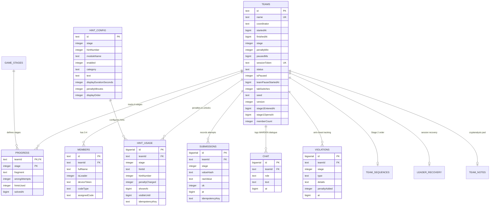

# FINAL OVERRIDE — Database Schema & Architecture

Comprehensive database schema documentation for the **FINAL OVERRIDE** escape room tech challenge. The system is designed with dual-backend support: local high-concurrency **SQLite** (via WAL mode with prepared statement caching) and hosted **Supabase PostgreSQL** (using Row Level Security and atomic PL/pgSQL RPCs).

---

## 1. Entity-Relationship Overview

---

## 2. Table Catalog & Column Definitions

### 2.1 `public.schema_version`
Tracks versioned migration execution.
- `version` (`INTEGER`, Primary Key): Migration sequence number (e.g. 1, 2, 3, 4).
- `applied_at` (`TIMESTAMPTZ`, NOT NULL): Clock timestamp of migration run.

### 2.2 `public.settings`
Key-value configuration store for runtime game state and coordinator controls.
- `key` (`TEXT`, Primary Key): Identifier (`clockPaused`, `gameStarted`, `startTogetherMode`, `leaderboardFreeze`, etc.).
- `value` (`TEXT`, NOT NULL): JSON or string representation of setting value.

### 2.3 `public.teams`
Core entity tracking team identity, current stage, penalty accumulation, and timers.
- `id` (`TEXT`, Primary Key): UUID/nano ID assigned at registration.
- `name` (`TEXT`, Unique, NOT NULL): Team display name.
- `coordinator` (`TEXT`, NOT NULL): Assigned coordinator name.
- `startedAt` (`BIGINT`, NOT NULL): Epoch milliseconds when team started Stage 1.
- `finishedAt` (`BIGINT`, Nullable): Epoch milliseconds when team completed Stage 6.
- `stage` (`INTEGER`, NOT NULL, Default `1`, CHECK `stage >= 1 AND stage <= 6`): Current active stage.
- `penaltyMin` (`INTEGER`, NOT NULL, Default `0`, CHECK `penaltyMin >= 0`): Cumulative time penalty in minutes.
- `pausedMs` (`BIGINT`, NOT NULL, Default `0`): Total milliseconds elapsed during global or team pauses.
- `sessionToken` (`TEXT`, Unique, Nullable): Cryptographic bearer token for leader session.
- `status` (`TEXT`, NOT NULL, Default `'active'`, CHECK `IN ('active', 'waiting', 'finished', 'timed_out')`).
- `isPaused` (`INTEGER`, NOT NULL, Default `0`, CHECK `IN (0, 1)`): Flag for team-specific pause.
- `teamPauseStartedAt` (`BIGINT`, NOT NULL, Default `0`): Epoch milliseconds when team pause began.
- `tabSwitches` (`INTEGER`, NOT NULL, Default `0`): Total verified tab switch violations.
- `seed` (`TEXT`, Nullable): Deterministic random seed for team-specific puzzles.
- `version` (`INTEGER`, NOT NULL, Default `1`): Monotonically increasing revision counter for optimistic locking.
- `stage1EnteredAt` (`BIGINT`, Nullable): Epoch milliseconds when team first loaded Stage 1.
- `stage1OpensAt` (`BIGINT`, Nullable): Epoch milliseconds when Stage 1 memorise phase ends (60 seconds after entry).
- `memberCount` (`INTEGER`, NOT NULL, Default `4`, CHECK `memberCount >= 3 AND memberCount <= 4`): Number of registered players.

### 2.4 `public.members`
Individual squad operatives (3 to 4 members per team).
- `id` (`TEXT`, Primary Key): Unique member ID.
- `teamId` (`TEXT`, NOT NULL, Foreign Key `teams.id` ON DELETE CASCADE).
- `fullName` (`TEXT`, NOT NULL): Operative full name.
- `isLeader` (`INTEGER`, NOT NULL, Default `0`, CHECK `IN (0, 1)`): 1 for designated squad leader.
- `deviceToken` (`TEXT`, Nullable): Device binding token assigned when joining Stage 5.
- `codeType` (`TEXT`, Nullable, CHECK `IN ('mixed', 'alpha')`): Stage 5 HMAC code profile.
- `assignedCode` (`TEXT`, Nullable): Generated shard code for Stage 5.

### 2.5 `public.game_stages`
Master lookup table defining the 6 canonical stages of FINAL OVERRIDE.
- `stage` (`INTEGER`, Primary Key, CHECK `stage >= 1 AND stage <= 6`).
- `name` (`TEXT`, NOT NULL): Identifier (`Signal Intercept`, `Decoding`, `Prompt the AI`, `CTF Challenges`, `Team Sync`, `Final Integration`).
- `title` (`TEXT`, NOT NULL): Stage UI banner title.
- `description` (`TEXT`, Nullable): Operational overview.

### 2.6 `public.team_sequences`
Deterministic puzzle sequence assigned to each team for Stage 2 layered decoding.
- `teamId` (`TEXT`, Primary Key, Foreign Key `teams.id` ON DELETE CASCADE).
- `fragmentOrder` (`TEXT`, NOT NULL): JSON serialized array of layer order.
- `expectedAnswer` (`TEXT`, NOT NULL): Required plaintext answer for Stage 2.
- `createdAt` (`BIGINT`, NOT NULL): Epoch milliseconds.

### 2.7 `public.progress`
Per-stage completion and attempt metrics.
- `teamId` (`TEXT`, Foreign Key `teams.id` ON DELETE CASCADE).
- `stage` (`INTEGER`, CHECK `stage >= 1 AND stage <= 6`).
- `fragment` (`TEXT`, Nullable): Revealed crypto fragment upon solving.
- `wrongAttempts` (`INTEGER`, NOT NULL, Default `0`): Count of rejected answers.
- `hintsUsed` (`INTEGER`, NOT NULL, Default `0`, CHECK `hintsUsed >= 0 AND hintsUsed <= 2`): Number of hints consumed (max 2).
- `solvedAt` (`BIGINT`, Nullable): Epoch milliseconds of stage completion.
- *Primary Key*: `(teamId, stage)`.

### 2.8 `public.submissions`
Immutable audit log of all answer submission attempts.
- `id` (`BIGSERIAL`, Primary Key).
- `teamId` (`TEXT`, NOT NULL, Foreign Key `teams.id` ON DELETE CASCADE).
- `stage` (`INTEGER`, NOT NULL, CHECK `stage >= 1 AND stage <= 6`).
- `valueHash` (`TEXT`, Nullable): SHA-256 hash of submitted answer.
- `rawValue` (`TEXT`, Nullable): Sanitized answer text for coordinator review.
- `ok` (`INTEGER`, NOT NULL, CHECK `IN (0, 1)`): 1 if correct, 0 if rejected.
- `at` (`BIGINT`, NOT NULL): Epoch milliseconds.
- `idempotencyKey` (`TEXT`, Nullable): Client-provided UUID preventing double submissions.

### 2.9 `public.hint_config`
System-wide catalog of two hints per stage (stages 2–6, 10 active hints). Stage 1 text hints were purged in migration 004 / 006 in favor of the repeatable Morse chart reveal policy in `hint_policy`.
- `id` (`TEXT`, Primary Key): e.g. `h2_1`, `h2_2`.
- `stage` (`INTEGER`, NOT NULL, CHECK `stage >= 1 AND stage <= 6`).
- `hintNumber` (`INTEGER`, NOT NULL, CHECK `IN (1, 2)`).
- `moduleName` (`TEXT`, NOT NULL).
- `enabled` (`INTEGER`, NOT NULL, Default `1`, CHECK `IN (0, 1)`).
- `category` (`TEXT`, NOT NULL, Default `'nudge'`).
- `text` (`TEXT`, NOT NULL): Hint content.
- `displayDurationSeconds` (`INTEGER`, NOT NULL, Default `0`): Duration if temporary reveal.
- `penaltyMinutes` (`INTEGER`, NOT NULL, Default `3`): Added penalty minutes.
- `displayOrder` (`INTEGER`, NOT NULL, Default `1`).
- `edited_by_admin` (`INTEGER`, NOT NULL, Default `0`).
- `updated_by` (`TEXT`, Nullable).

### 2.10 `public.hint_policy`
Stage-level hint rules governing repeatability, costs, countdown durations, and display mechanics. Introduced in SQLite migration 004 and Supabase migration 006.
- `stage` (`INTEGER`, Primary Key, CHECK `stage >= 1 AND stage <= 6`).
- `kind` (`TEXT`, NOT NULL, CHECK `kind IN ('chart_reveal', 'text_hints')`): `'chart_reveal'` for Stage 1; `'text_hints'` for Stages 2–6.
- `displaySeconds` (`INTEGER`, NOT NULL, Default `30`): Window duration (30 seconds for Stage 1 chart reveal; 0 for persistent text hints).
- `costScheduleMinutes` (`TEXT`, NOT NULL, Default `'[3, 5]'`): JSON array specifying penalty schedule (e.g. `[3, 5]` means 1st use costs +3m, subsequent uses cost +5m).
- `maxHints` (`INTEGER`, NOT NULL, Default `-1`): `-1` for unlimited repeatable uses (Stage 1); `2` for Stages 2–6.
- `repeatable` (`INTEGER`, NOT NULL, Default `1`, CHECK `repeatable IN (0, 1)`): 1 for Stage 1, 0 for Stages 2–6.
- `enabled` (`INTEGER`, NOT NULL, Default `1`, CHECK `enabled IN (0, 1)`).
- `updatedAt` (`BIGINT`, NOT NULL).

### 2.11 `public.hint_usage`
Records each team's unlocked hints, active countdown windows, and penalty transactions.
- `id` (`BIGSERIAL`, Primary Key).
- `teamId` (`TEXT`, NOT NULL, Foreign Key `teams.id` ON DELETE CASCADE).
- `stage` (`INTEGER`, NOT NULL, CHECK `stage >= 1 AND stage <= 6`).
- `hintId` (`TEXT`, NOT NULL): e.g. `'stage_1_chart'` or `'h2_1'`.
- `hintNumber` (`INTEGER`, NOT NULL, CHECK `hintNumber >= 1`): Incremental request count (1, 2, 3... for repeatable hints; 1 or 2 for stages 2–6).
- `penaltyCharged` (`INTEGER`, NOT NULL, Default `0`).
- `shownAt` (`BIGINT`, NOT NULL): Epoch milliseconds of hint activation.
- `visibleUntil` (`BIGINT`, NOT NULL, Default `0`): Epoch milliseconds when temporary display expires.
- `idempotencyKey` (`TEXT`, Nullable): Client UUID preventing duplicate penalty deduction.
- *Constraint*: `UNIQUE ("teamId", stage, "hintNumber")`.

### 2.12 `public.chat`
Full transcript of neural WARDEN interaction in Stage 3.
- `id` (`BIGSERIAL`, Primary Key).
- `teamId` (`TEXT`, NOT NULL, Foreign Key `teams.id` ON DELETE CASCADE).
- `role` (`TEXT`, NOT NULL): `'user'` or `'assistant'`.
- `text` (`TEXT`, NOT NULL).
- `at` (`BIGINT`, NOT NULL).

### 2.12 `public.violations`
Anti-cheat event ledger tracking tab switching and unauthorized actions.
- `id` (`BIGSERIAL`, Primary Key).
- `teamId` (`TEXT`, NOT NULL, Foreign Key `teams.id` ON DELETE CASCADE).
- `stage` (`INTEGER`, NOT NULL, Default `0`).
- `type` (`TEXT`, NOT NULL): `'tab_switch'`, `'rate_limit'`, etc.
- `details` (`TEXT`, Nullable).
- `penaltyAdded` (`INTEGER`, NOT NULL, Default `0`).
- `at` (`BIGINT`, NOT NULL).

### 2.13 `public.leader_recovery`
One-time emergency codes generated by coordinators to restore disconnected squad leaders.
- `teamId` (`TEXT`, Primary Key, Foreign Key `teams.id` ON DELETE CASCADE).
- `code` (`TEXT`, NOT NULL).
- `expiresAt` (`BIGINT`, NOT NULL).
- `used` (`INTEGER`, NOT NULL, Default `0`, CHECK `IN (0, 1)`).

### 2.14 `public.admin_sessions`
Hashed session tokens for authenticated coordinators and system administrators.
- `id` (`TEXT`, Primary Key).
- `tokenHash` (`TEXT`, Unique, NOT NULL).
- `createdAt` (`BIGINT`, NOT NULL).
- `expiresAt` (`BIGINT`, NOT NULL).

### 2.15 `public.team_notes`
Cryptanalysis scratchpad persisted per team.
- `teamId` (`TEXT`, Primary Key, Foreign Key `teams.id` ON DELETE CASCADE).
- `notes` (`TEXT`, NOT NULL, Default `''`).
- `updatedAt` (`BIGINT`, NOT NULL).

### 2.16 `public.audit_log`
Immutable administrative audit log.
- `id` (`BIGSERIAL`, Primary Key).
- `actor` (`TEXT`, NOT NULL).
- `action` (`TEXT`, NOT NULL).
- `details` (`TEXT`, Nullable).
- `at` (`BIGINT`, NOT NULL).

### 2.17 `public.stage2_workbench`
Synchronized cryptanalysis workbench state for Stage 2.
- `team_id` (`TEXT`, Primary Key, Foreign Key `teams.id` ON DELETE CASCADE).
- `payload_loaded` (`INTEGER` / `BOOLEAN`, NOT NULL, Default `0`).
- `steps` (`TEXT` JSON string in SQLite / `JSONB` in Supabase, NOT NULL, Default `'[]'`).
- `version` (`INTEGER`, NOT NULL, Default `1`).
- `updated_at` (`BIGINT`, NOT NULL).

### 2.18 `public.stage2_workbench_log`
Audit trail of all cryptanalysis transformations applied by squads.
- `id` (`BIGSERIAL` / `INTEGER PRIMARY KEY AUTOINCREMENT`).
- `team_id` (`TEXT`, NOT NULL, Foreign Key `teams.id` ON DELETE CASCADE).
- `action` (`TEXT`, NOT NULL).
- `details` (`TEXT` JSON / `JSONB`, Nullable).
- `version` (`INTEGER`, NOT NULL).
- `created_at` (`BIGINT`, NOT NULL).

### 2.19 `public.event_state`
Global event configuration and clock state.
- `id` (`INTEGER`, Primary Key, CHECK `id = 1`).
- `mode` (`TEXT`, NOT NULL, Default `'self_paced'`, CHECK `mode IN ('self_paced', 'synchronized')`).
- `event_start_time` (`BIGINT`, Nullable).
- `cap_minutes` (`INTEGER`, NOT NULL, Default `90`).
- `is_paused` (`INTEGER` / `BOOLEAN`, NOT NULL, Default `0`).
- `pause_start_time` (`BIGINT`, Nullable).
- `total_paused_ms` (`BIGINT`, NOT NULL, Default `0`).
- `updated_at` (`BIGINT`, NOT NULL).

### 2.20 `public.schema_version`
Tracks applied database migrations.
- `version` (`INTEGER`, Primary Key).
- `applied_at` (`BIGINT`, NOT NULL).
- `description` (`TEXT`, NOT NULL).

---

## 3. Stored Procedures & Functions Catalog (Migrations 001–005)

All functions execute with `SECURITY DEFINER` and strict `SET search_path = ''`.

| Function | Parameters | Returns | Description |
| :--- | :--- | :--- | :--- |
| `ping()` | - | `jsonb` | Verifies DB health and clock offset. |
| `register_team()` | `p_team jsonb, p_members jsonb, p_stages int, p_sequence jsonb` | `jsonb` | Atomically creates team, members, sequence, and 6 stage progress rows. |
| `join_member()` | `p_team_id text, p_member_id text, p_device_token text` | `jsonb` | Binds member device in Stage 5. |
| `get_team_state()` | `p_session_token text` | `jsonb` | Fetches full hydrated team state, members, progress, and sequence. |
| `submit_answer()` | `p_team_id text, p_stage int, p_raw_value text, p_value_hash text, p_ok int, p_at bigint, p_idempotency_key text` | `jsonb` | Idempotent answer submission with wrong attempt incrementing. |
| `request_hint()` | `p_team_id text, p_stage int, p_hint_number int, p_shown_at bigint, p_visible_until bigint, p_penalty_charged int, p_idempotency_key text` | `jsonb` | Idempotent hint request, applies time penalty and records timer. |
| `advance_stage()` | `p_team_id text, p_next_stage int, p_now bigint, p_stage1_opens_at bigint` | `jsonb` | Advances team stage or marks finished if stage > 6. |
| `add_violation()` | `p_team_id text, p_stage int, p_type text, p_details text, p_penalty_added int, p_at bigint` | `jsonb` | Records violation and increments tab switches/penalties. |
| `set_team_notes()` | `p_team_id text, p_notes text, p_updated_at bigint` | `jsonb` | Upserts team cryptanalysis notepad. |
| `pause_team()` | `p_team_id text, p_paused_at bigint` | `jsonb` | Sets team paused status and records pause start time. |
| `resume_team()` | `p_team_id text, p_resumed_at bigint` | `jsonb` | Resumes team and credits elapsed paused duration. |
| `set_global_pause()` | `p_paused boolean, p_now bigint` | `jsonb` | Global event pause toggle; credits pause duration to all active teams upon resume. |
| `adjust_penalty()` | `p_team_id text, p_delta_min int` | `jsonb` | Manually adjusts team penalty minutes. |
| `reset_stage()` | `p_team_id text, p_stage int, p_now bigint` | `jsonb` | Rolls back team progress and clears submissions from specified stage onward. |
| `reissue_leader_session()` | `p_team_id text, p_new_token text` | `jsonb` | Updates session token for disconnected team leader. |
| `redeem_leader_code()` | `p_team_id text, p_code text, p_new_token text, p_now bigint` | `jsonb` | Validates recovery code and reissues leader session token. |
| `launch_game()` | `p_now bigint` | `jsonb` | Global start: moves all waiting teams to active and starts Stage 1 60s timer. |
| `get_leaderboard()` | `p_now bigint, p_include_all boolean` | `jsonb` | Computes live leaderboard with elapsed time and penalty weighting. |
| `admin_overview()` | - | `jsonb` | Fetches consolidated teams, settings, recent submissions and violations. |
| `get_hint_configs()` | - | `jsonb` | Returns full hint configuration catalog. |
| `update_hint_config()` | `p_id text, p_fields jsonb` | `jsonb` | Updates text, penalties, or enable state of a hint. |
| `export_results()` | - | `jsonb` | Exports full event state for backup and archival. |
| `stage2_workbench_get()` | `p_team_id text` | `jsonb` | Fetches Stage 2 cryptanalysis workbench state (`payloadLoaded`, `steps`, `version`). |
| `stage2_workbench_save()` | `p_team_id text, p_payload_loaded boolean, p_steps jsonb, p_expected_version int, p_now bigint, p_action text, p_details jsonb` | `jsonb` | Optimistic concurrency update for Stage 2 workbench. |
| `event_state_get()` | - | `jsonb` | Fetches global event clock and configuration state. |
| `event_state_update()` | `p_fields jsonb, p_now bigint` | `jsonb` | Updates global event state and logs administrative audit entry. |
